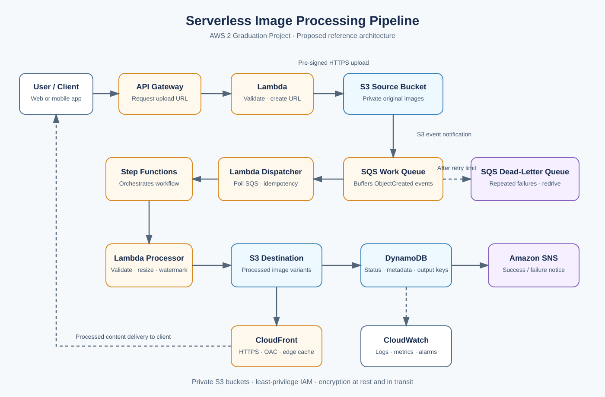

# AWS 2 Project — Serverless Image Processing Pipeline

**Course:** AWS Solutions Architect – Associate  
**Project:** Project 2 — Serverless Image Processing Pipeline with S3, SQS & Lambda  
**Prepared by:** [Student Name]  
**Status:** Reference architecture and implementation plan. Deployment evidence and measured test results must be added after implementation.

## 1. Project Overview

This project designs a serverless, event-driven image-processing pipeline. Users upload image files and choose an output size, frame, or watermark. The system validates the upload, asynchronously processes the image, stores generated variants, records metadata and job status, and serves the finished images globally.

The design uses managed AWS services to handle variable demand without maintaining an always-on application or worker fleet. Amazon S3 stores source and output files, Amazon SQS buffers work, AWS Lambda performs request handling and image processing, AWS Step Functions orchestrates the workflow, DynamoDB stores metadata, SNS sends notifications, and CloudFront delivers processed files.

## 2. Business Problem and Objectives

A single image-processing server can become overloaded during upload spikes. Performing image transformations synchronously can also make uploads slow and increase failed requests. The solution separates the upload path from the processing path and provides durable storage, retry handling, metadata tracking, and controlled content delivery.

Objectives:
- Accept uploads without exposing long-lived AWS credentials to clients.
- Buffer work so sudden upload bursts do not overwhelm processing.
- Validate image files and create resized/watermarked variants.
- Store source and output files in private S3 buckets.
- Track ownership, metadata, and processing status in DynamoDB.
- Isolate repeatedly failing jobs in an SQS dead-letter queue (DLQ).
- Deliver processed images through CloudFront while keeping the S3 origin private.
- Monitor failures, latency, queue backlog, and cost.

## 3. Architecture Diagram

The flow is: client → API Gateway → upload URL Lambda → pre-signed S3 upload → S3 ObjectCreated notification → SQS work queue → dispatcher Lambda → Step Functions → validation and image-processing Lambda → destination S3 + DynamoDB → SNS notification. CloudFront serves processed images from the private destination bucket using Origin Access Control (OAC). Repeatedly failing queue messages are isolated in the DLQ.

## 4. AWS Services

| Service | Purpose |
|---|---|
| Amazon API Gateway | Public HTTPS endpoint for requesting an upload URL. |
| AWS Lambda — Upload URL | Validates the request and creates a short-lived S3 pre-signed URL. |
| Amazon S3 — Source bucket | Stores original uploaded images privately. |
| Amazon SQS — Work queue | Buffers object-created events and decouples uploads from processing. |
| Amazon SQS — DLQ | Stores messages that repeatedly fail, for investigation and controlled redrive. |
| AWS Lambda — Dispatcher | Consumes SQS messages, applies idempotency checks, and starts workflow execution. |
| AWS Step Functions | Orchestrates validation, transformation, output storage, metadata updates, and failure handling. |
| AWS Lambda — Image processor | Resizes images and applies the selected frame or watermark (for example, using Pillow packaged with the function). |
| Amazon S3 — Destination bucket | Stores generated image variants. |
| Amazon DynamoDB | Stores image ID, owner reference, status, timestamps, dimensions, and output keys. |
| Amazon SNS | Sends job completion or failure notifications. |
| Amazon CloudFront | Caches processed images near users and serves them over HTTPS. |
| Amazon CloudWatch | Collects logs/metrics and triggers operational alarms. |

## 5. End-to-End Workflow

1. The client calls the API Gateway upload endpoint.
2. The upload URL Lambda validates file type/size metadata, generates a server-controlled object key, and returns a short-lived pre-signed URL.
3. The client uploads the original image directly to the private S3 source bucket over HTTPS.
4. S3 sends an `ObjectCreated` event to the SQS work queue.
5. A Lambda event source mapping polls SQS. The dispatcher validates the event, checks a stable idempotency key, and starts a Step Functions execution.
6. Step Functions coordinates image validation and invokes the image-processing Lambda.
7. The image processor creates requested variants and writes them to the destination S3 bucket.
8. The workflow updates the DynamoDB record with status, timestamps, dimensions, and output keys.
9. SNS publishes a completion/failure notification.
10. CloudFront delivers processed images from the private S3 origin using OAC. Signed URLs/cookies can be added if viewer-level authorization is required.

## 6. Metadata Model

Use `imageId` as the DynamoDB partition key. Example attributes:

| Attribute | Purpose |
|---|---|
| `imageId` | Unique identifier created by the application. |
| `ownerId` | User or tenant that owns the image. |
| `sourceKey` | S3 object key of the original. |
| `status` | `UPLOADED`, `PROCESSING`, `COMPLETED`, or `FAILED`. |
| `createdAt`, `completedAt` | UTC timestamps. |
| `outputKeys` | Keys for thumbnail and processed variants. |
| `width`, `height`, `format` | Validated image properties. |
| `errorCode` | Sanitized failure code for troubleshooting. |

## 7. Reliability and Error Handling

- **SQS buffering:** absorbs short-lived traffic spikes and lets processing scale independently from uploads.
- **Retries:** configure bounded Step Functions retries with exponential backoff for transient errors, plus Catch paths for terminal failures.
- **DLQ:** configure a redrive policy. Alert when the DLQ contains messages; investigate and fix the cause before redriving.
- **Visibility timeout:** configure the source queue visibility timeout in line with Lambda timeout and batching-window settings. Follow AWS guidance for SQS event source mappings and validate the selected values.
- **Idempotency:** S3 notifications and SQS/Lambda delivery can repeat. Use a stable job ID and conditional DynamoDB writes so duplicate events do not create duplicate side effects or customer notifications.
- **Source preservation:** retain originals until successful processing or until an approved retention policy permits deletion.

## 8. Security

- Enable S3 Block Public Access on both buckets.
- Use separate least-privilege IAM roles for the upload URL Lambda, dispatcher, image processor, and Step Functions execution role.
- Restrict the SQS queue policy to the intended source bucket and AWS account.
- Use short-lived pre-signed URLs, server-generated object keys, and validate actual image contents after upload.
- Use CloudFront with an S3 REST origin and Origin Access Control (OAC); do not make the origin bucket public.
- Enforce HTTPS for API requests and content delivery.
- Enable S3 server-side encryption. Use KMS customer-managed keys when key-policy control or auditable key usage is required.
- Do not hardcode credentials. Use Secrets Manager or Systems Manager Parameter Store if secrets are needed.
- Enable CloudTrail for account/API auditing and CloudWatch Logs for operational diagnostics. Never log pre-signed URLs or sensitive file contents.

## 9. Monitoring and Operations

| Area | Signals | Response |
|---|---|---|
| SQS work queue | Visible messages; age of oldest message | Alert when backlog or message age exceeds the service objective. |
| SQS DLQ | Visible messages | Alert when greater than zero; investigate before redrive. |
| Lambda | Errors, throttles, duration, concurrency | Investigate failures, timeouts, and concurrency limits. |
| Step Functions | Failed, timed-out, aborted executions | Inspect execution history and failed state. |
| DynamoDB | Throttling and system errors | Review capacity and access patterns. |
| CloudFront/S3 | Cache hit ratio, origin errors, 4xx/5xx | Review cache behavior, origin policy, and object keys. |

Use AWS Budgets and Cost Explorer. Actual costs depend on Region, image count/size, Lambda duration, state transitions, retention, data transfer, and CloudFront cache-hit ratio.

## 10. Cost Optimization

- Use Lambda and SQS on demand instead of an always-running EC2 worker fleet.
- Start with DynamoDB on-demand capacity while traffic is unpredictable; reconsider after observing real usage.
- Use CloudFront caching to reduce repeated requests to the S3 origin.
- Apply S3 lifecycle transitions only after reviewing access patterns, retrieval needs, and minimum storage-duration charges.
- Set budget alerts and review Cost Explorer regularly.

## 11. Implementation Plan

1. Select an AWS Region, tag resources (`Project=ServerlessImagePipeline`), define accepted formats/sizes, and set a budget alert.
2. Create private source/destination S3 buckets with Block Public Access and default encryption.
3. Create separate least-privilege IAM roles.
4. Create a DynamoDB metadata table with `imageId` as partition key.
5. Create an SQS work queue and DLQ; configure retention, redrive, and visibility settings.
6. Create the upload URL Lambda and API Gateway endpoint.
7. Configure the S3 `ObjectCreated` notification to send events to SQS and restrict the queue policy by source bucket/account.
8. Build the dispatcher Lambda and Step Functions state machine.
9. Package/test an image library such as Pillow and implement validation, resize, and watermark/frame processing.
10. Configure CloudFront with the destination S3 bucket as a private origin using OAC.
11. Configure SNS subscriptions and CloudWatch alarms.
12. Execute the acceptance tests and save sanitized screenshots, test results, and cost observations.

## 12. Test Plan and Acceptance Criteria

The following are planned tests, not claims that deployment or tests have already completed. Record actual outcomes after implementation.

| Test | Procedure | Expected result |
|---|---|---|
| Valid upload | Upload supported JPEG/PNG using a pre-signed URL. | Upload succeeds and job eventually reaches `COMPLETED`. |
| Output correctness | Inspect generated thumbnail and processed image. | Dimensions and selected frame/watermark are correct. |
| Invalid file | Upload unsupported format or invalid content. | Validation fails safely; status becomes `FAILED`; no invalid output is published. |
| Duplicate event | Replay the same S3 event. | Idempotency prevents duplicate side effects/notifications. |
| Transient failure | Cause a temporary worker error, then restore it. | Retry runs and job can complete without losing the source file. |
| DLQ handling | Cause repeated processing failure. | Message moves to DLQ and alarm is raised. |
| Access control | Try direct public S3 access. | Access is denied; approved delivery uses the authorized CloudFront/application path. |
| Expired URL | Upload after pre-signed URL expires. | S3 rejects the request. |
| Burst workload | Upload many representative images quickly. | SQS buffers the work; backlog drains as processing scales. |
| Observability | Trigger a known workflow failure. | Logs, metrics, and relevant alarm/notification are available. |

A fillable test log is provided in [`tests/test-plan.md`](tests/test-plan.md).

## 13. Risks and Mitigations

| Risk | Mitigation |
|---|---|
| Duplicate event delivery | Stable idempotency key and conditional DynamoDB writes. |
| Large images exceed runtime/memory limits | Enforce upload limits and benchmark representative images. |
| Unauthorized access | Private S3 buckets, OAC, narrow bucket policies, and signed viewer access if required. |
| Unexpected cost increase | Budgets and monitoring for invocations, duration, state transitions, storage, and transfer. |
| Failed jobs remain unresolved | Alarm on DLQ depth and document triage/redrive steps. |

## 14. Project Status and Submission Evidence

This repository contains the proposed architecture, report, and acceptance-test plan. The architecture is a design and implementation plan; do not describe it as deployed until AWS resources have been created and tested.

Before final submission, add:
- AWS Console screenshots with sensitive account information removed.
- Actual pass/fail results for each test.
- Region and configuration notes.
- Cost observations from the deployed environment.
- A live demo URL or recorded walkthrough, if available (optional).

## 15. References

- [Amazon S3 event notifications](https://docs.aws.amazon.com/AmazonS3/latest/userguide/EventNotifications.html)
- [Using AWS Lambda with Amazon SQS](https://docs.aws.amazon.com/lambda/latest/dg/with-sqs.html)
- [Configuring an Amazon SQS event source mapping](https://docs.aws.amazon.com/lambda/latest/dg/services-sqs-configure.html)
- [Download and upload objects with pre-signed URLs](https://docs.aws.amazon.com/AmazonS3/latest/userguide/using-presigned-url.html)
- [Restrict access to an Amazon S3 origin with CloudFront OAC](https://docs.aws.amazon.com/AmazonCloudFront/latest/DeveloperGuide/private-content-restricting-access-to-s3.html)
- [Handling error conditions in AWS Step Functions](https://docs.aws.amazon.com/step-functions/latest/dg/tutorial-handling-error-conditions.html)
- [AWS Step Functions documentation](https://aws.amazon.com/documentation-overview/step-functions/)
