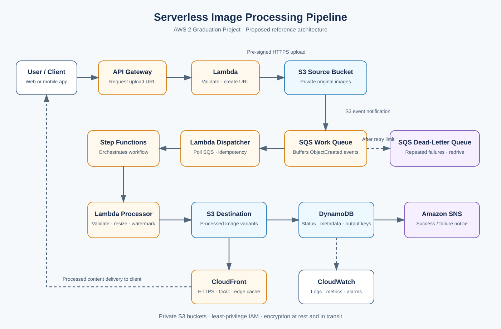

# AWS 2 Project Submission Report
## Serverless Image Processing Pipeline with Amazon S3, SQS, Lambda and Step Functions

**Course:** AWS Solutions Architect – Associate  
**Project category:** Serverless / Event-Driven Architecture  
**Prepared by:** [Student Name]  
**Report status:** Proposed architecture and implementation plan

> **Submission integrity note:** This document describes the proposed design and implementation plan. It does not claim that the AWS infrastructure has already been deployed or that acceptance tests have passed. Add deployment screenshots, actual test outcomes, and cost observations after implementation.

## 1. Executive Summary

This project proposes a serverless image-processing pipeline for an application where users upload images and choose a frame, watermark, or output size. After upload, the system validates the image, creates resized and watermarked variants, stores the processed files, records metadata and status, and makes completed images available through CloudFront.

Amazon S3 provides durable object storage. Amazon SQS buffers upload events and decouples processing from the user upload path. AWS Lambda handles upload URL generation, event dispatch, and image transformations. AWS Step Functions orchestrates the multi-step workflow. DynamoDB stores image metadata and processing status. Amazon SNS sends completion or failure notifications. Amazon CloudFront caches and delivers processed files globally.

The architecture avoids an always-on image-processing server and is designed to absorb variable demand. Retries, idempotency, and a dead-letter queue help isolate failures and prevent duplicate side effects.

## 2. Business Problem

Image transformations can require variable processing time and compute resources. A single server may become a bottleneck when many users upload images at once. If processing is performed synchronously in the upload request, upload latency increases and transient processing failures can affect the user's experience.

The proposed solution separates image upload from image processing. Uploads go directly to S3 by using pre-signed URLs. S3 sends object-created events to SQS. Lambda and Step Functions process jobs asynchronously, while status and output details are stored separately from the image files.

## 3. Project Objectives

- Accept image uploads without exposing long-lived AWS credentials to clients.
- Keep the upload path short and move transformations to an asynchronous workflow.
- Buffer processing requests so temporary spikes do not overwhelm workers.
- Validate uploaded images and create resized/watermarked variants.
- Store original and processed objects in private S3 buckets.
- Track ownership reference, metadata, timestamps, output keys, and processing status.
- Retry transient failures and isolate repeatedly failing jobs in an SQS DLQ.
- Deliver processed images through CloudFront while keeping the S3 origin private.
- Monitor errors, duration, concurrency, queue backlog, and cost.

## 4. Scope and Assumptions

### In scope
- Upload URL API and private S3 upload flow.
- S3 event notifications, SQS buffering, Lambda event handling, and DLQ.
- Step Functions orchestration for validation and transformation.
- DynamoDB metadata and job-status tracking.
- CloudFront delivery and OAC-protected S3 origin.
- Security controls, logging, alarms, cost considerations, and acceptance-test plan.

### Assumptions
- Initial deployment is in one AWS Region.
- JPEG and PNG are the initial supported input formats.
- The application will define maximum object size, permitted output dimensions, and the available frame/watermark choices.
- The initial version is not a multi-Region disaster recovery deployment.
- Retention duration and end-user authorization requirements will be defined by the project owner.

## 5. Proposed Architecture

### Main design decisions

| Component | Design decision | Reason |
|---|---|---|
| Upload path | API Gateway + Lambda + S3 pre-signed URL | Provides a controlled upload endpoint without proxying large files through Lambda. |
| Original storage | Private S3 source bucket | Separates original images from generated content and supports independent policies. |
| Event buffer | SQS standard queue + DLQ | Buffers bursts and isolates repeatedly failing messages. |
| Orchestration | Step Functions | Makes workflow states visible and provides retry/catch behavior. |
| Processing | Lambda image processor | Executes on demand without managing EC2 worker servers. |
| Metadata | DynamoDB | Stores job status and image attributes independently of object storage. |
| Notifications | SNS | Publishes processing success or failure to subscribed endpoints. |
| Global delivery | CloudFront + S3 OAC | Caches content close to viewers without making the S3 origin public. |

## 6. End-to-End Processing Workflow

1. The client calls an API Gateway endpoint to request an upload URL.
2. The upload-URL Lambda validates the request, generates a server-controlled object key, and returns a short-lived pre-signed URL.
3. The client uploads the image directly to the private S3 source bucket over HTTPS.
4. S3 emits an ObjectCreated event to the SQS work queue.
5. A Lambda event source mapping polls SQS. The dispatcher validates the message, checks an idempotency record, and starts a Step Functions execution.
6. The workflow validates the image type, object key, and size, then invokes the image-processing Lambda.
7. The processor creates requested thumbnail/resized and watermarked/frame variants and writes them to the destination S3 bucket.
8. The workflow updates the DynamoDB item with status, timestamps, dimensions, and destination object keys.
9. SNS publishes the completion/failure notification.
10. CloudFront serves processed objects from the private destination bucket using Origin Access Control. Signed URLs or cookies can be added if viewer-level authorization is required.

## 7. DynamoDB Metadata Model

Use `imageId` as the partition key. Example attributes:

| Attribute | Purpose |
|---|---|
| `imageId` | Unique identifier generated by the API. |
| `ownerId` | User or tenant that owns the image. |
| `sourceKey` | Key of the original S3 object. |
| `status` | `UPLOADED`, `PROCESSING`, `COMPLETED`, or `FAILED`. |
| `createdAt` / `completedAt` | UTC timestamps. |
| `outputKeys` | Keys for thumbnail and processed variants. |
| `width`, `height`, `format` | Validated image properties. |
| `errorCode` | Sanitized error code for support. |

## 8. Reliability and Failure Handling

### Asynchronous decoupling
SQS absorbs upload bursts and allows the processing rate to differ from the upload rate. Upload completion does not require image transformation to finish.

### Retry strategy
Use bounded retries with exponential backoff for transient errors in Step Functions. Use Catch paths to record terminal failures and publish a failure notification.

### Dead-letter queue
Configure an SQS DLQ and redrive policy. Alarm when the DLQ contains messages. Investigate the error and correct its cause before redriving a message.

### Visibility timeout
Configure the source queue visibility timeout in accordance with the Lambda timeout and batching window. Follow the current AWS guidance for SQS event source mappings and validate the chosen settings.

### Idempotency
S3 notifications and SQS/Lambda processing may deliver an event more than once. Use a stable job ID based on source object identity/version and conditional DynamoDB writes. Check job state before repeating side effects, and avoid duplicate notifications.

### Preserve originals
Keep original files until successful processing or until an approved lifecycle/retention policy permits deletion.

## 9. Security Design

- Enable S3 Block Public Access for both source and destination buckets.
- Use separate least-privilege IAM roles for upload URL generation, dispatcher, image processor, and Step Functions execution.
- Restrict the SQS queue policy to the intended source bucket and AWS account.
- Use short-lived pre-signed URLs, server-generated object keys, content-type/size constraints, and post-upload file validation.
- Configure CloudFront with an S3 REST origin and Origin Access Control; do not make the origin bucket public.
- Require HTTPS for API access and content delivery.
- Enable S3 server-side encryption. Use KMS customer-managed keys when key-policy control or auditable key usage is required.
- Avoid credentials in source code. Use Secrets Manager or Parameter Store if a secret is required.
- Enable CloudTrail for account/API auditing and CloudWatch Logs for diagnostics. Do not log pre-signed URLs or sensitive image contents.

## 10. Monitoring and Operations

| Area | Metrics/signals | Response |
|---|---|---|
| SQS work queue | Visible messages; age of oldest message | Alert when backlog or age exceeds the agreed processing objective. |
| SQS DLQ | Visible messages | Alert when greater than zero; investigate before redrive. |
| Lambda | Errors, throttles, duration, concurrency | Review failures, timeouts, and concurrency limits. |
| Step Functions | Failed, timed-out, and aborted executions | Inspect execution history to identify failing state. |
| DynamoDB | Throttling and system errors | Review access patterns and capacity settings. |
| CloudFront/S3 | Cache hit ratio, origin errors, 4xx/5xx | Review cache policy, origin permissions, and object keys. |

Use CloudWatch dashboards and alarms for operations. Create an AWS Budget and use Cost Explorer to monitor spend.

## 11. Cost Optimization

- Use Lambda and SQS on demand instead of maintaining an always-running EC2 worker fleet.
- Start with DynamoDB on-demand capacity while traffic is uncertain; revisit the decision based on measured traffic.
- Use CloudFront caching to reduce repeated requests to the origin and lower latency.
- Apply S3 lifecycle rules only after reviewing access patterns, retrieval requirements, and minimum storage-duration charges.
- Keep workflow states and function invocations lean.
- Review AWS Budgets and Cost Explorer as image volume grows.

## 12. Implementation Plan

1. Select an AWS Region; tag resources with `Project=ServerlessImagePipeline`; define accepted formats, maximum size, output variants, retention policy, and budget alert.
2. Create private S3 source and destination buckets with Block Public Access and default encryption.
3. Create dedicated least-privilege IAM roles for each Lambda function and Step Functions.
4. Create a DynamoDB metadata table with `imageId` as partition key.
5. Create the SQS work queue and DLQ; configure redrive, retention, and visibility settings.
6. Create the upload-URL Lambda and API Gateway endpoint.
7. Configure S3 ObjectCreated notification to SQS and restrict the queue policy by source bucket/account.
8. Implement the dispatcher Lambda and Step Functions state machine.
9. Package and test an image library such as Pillow; implement image validation, resize, and watermark/frame steps.
10. Configure CloudFront with the destination S3 bucket as a private origin using OAC.
11. Configure SNS subscriptions and CloudWatch alarms.
12. Execute the acceptance tests, save sanitized screenshots, record actual outcomes and cost observations, and update this report.

## 13. Acceptance Test Plan

These are proposed tests. They must be executed after deployment; do not mark them passed before actual validation.

| Test | Procedure | Expected result |
|---|---|---|
| Valid upload | Request a pre-signed URL and upload a supported JPEG/PNG. | Upload succeeds, event is queued, job becomes COMPLETED. |
| Output validation | Inspect generated images. | Dimensions and selected frame/watermark are correct. |
| Invalid input | Upload unsupported format or invalid file content. | Validation fails safely; status becomes FAILED and invalid output is not published. |
| Duplicate event | Replay the same S3 event. | Idempotency prevents duplicate side effects/notifications. |
| Transient failure | Cause temporary processor error and restore it. | Configured retry runs and job completes without losing original. |
| DLQ handling | Cause processing to fail repeatedly. | Message reaches DLQ and alarm fires. |
| Access control | Attempt direct public S3 object access. | Direct public access is denied. |
| Expired URL | Use a pre-signed URL after expiry. | Upload is rejected. |
| Burst traffic | Upload many representative images quickly. | SQS buffers requests and backlog drains as workers scale. |
| Observability | Trigger known workflow error. | Logs, metrics, and relevant alarm/notification are available. |

A fillable checklist is available in [the test plan](../tests/test-plan.md).

## 14. Risks and Mitigations

| Risk | Mitigation |
|---|---|
| Duplicate event delivery | Stable idempotency key and conditional DynamoDB writes. |
| Very large images exceed Lambda limits | Enforce upload limits and benchmark representative images before deployment. |
| Unauthorized image access | Private S3 buckets, OAC, narrow bucket policies, and signed viewer access if required. |
| Unexpected spending | Budgets and monitoring for invocations, duration, state transitions, storage, and transfer. |
| Failed jobs remain unresolved | DLQ alarms and documented triage/redrive procedure. |

## 15. Conclusion

The proposed architecture combines managed AWS services to separate uploads from processing, absorb bursts, orchestrate transformations, track job state, and deliver content globally. S3 stores the image objects, SQS and its DLQ improve resilience, Lambda and Step Functions minimize server management, DynamoDB stores metadata, SNS notifies users, and CloudFront improves global delivery while OAC protects the S3 origin.

The next step is to deploy the architecture in a controlled AWS account, execute the acceptance tests, record actual results and costs, and add sanitized screenshots before final submission.

## 16. References

- [Amazon S3 event notifications](https://docs.aws.amazon.com/AmazonS3/latest/userguide/EventNotifications.html)
- [Using AWS Lambda with Amazon SQS](https://docs.aws.amazon.com/lambda/latest/dg/with-sqs.html)
- [Configuring an Amazon SQS event source mapping](https://docs.aws.amazon.com/lambda/latest/dg/services-sqs-configure.html)
- [Download and upload objects with pre-signed URLs](https://docs.aws.amazon.com/AmazonS3/latest/userguide/using-presigned-url.html)
- [Restrict access to an Amazon S3 origin with CloudFront OAC](https://docs.aws.amazon.com/AmazonCloudFront/latest/DeveloperGuide/private-content-restricting-access-to-s3.html)
- [Handling error conditions in AWS Step Functions](https://docs.aws.amazon.com/step-functions/latest/dg/tutorial-handling-error-conditions.html)
- [AWS Step Functions documentation](https://aws.amazon.com/documentation-overview/step-functions/)
